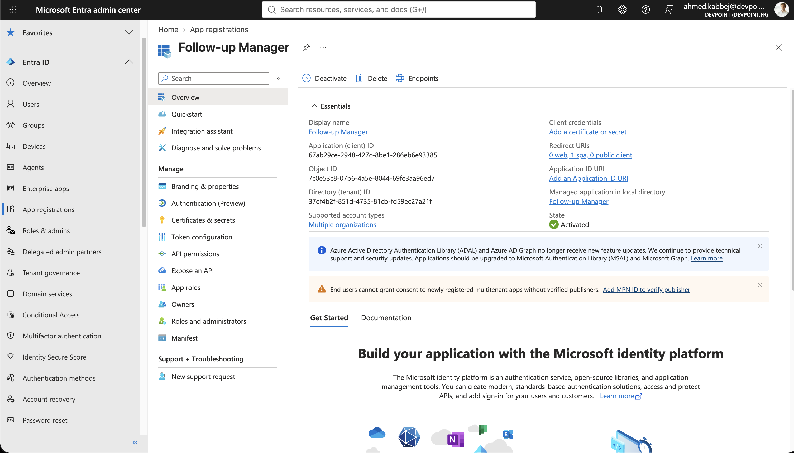

# Follow-up Manager

**Ne plus oublier les emails importants.**

Follow-up Manager se connecte à votre Outlook et transforme les emails importants en **suivis** : une échéance, un statut (à traiter, en attente, terminé) et des notes. Un tableau de bord montre les relances en retard et les échéances de la semaine, et chaque suivi s'ouvre directement dans Outlook.

## Se connecter

1. Installez Node.js 20 ou plus récent, puis lancez :

   ```bash
   npm install
   cp .env.example .env
   npm run dev
   ```

2. Renseignez dans `.env` les identifiants de l'application Microsoft Entra ID (page **Vue d'ensemble**) :

   ```
   VITE_MS_CLIENT_ID=<ID d'application (client)>
   VITE_MS_TENANT_ID=<ID de l'annuaire (locataire)>
   VITE_MS_REDIRECT_URI=http://localhost:5173/redirect.html
   ```

   Dans Entra ID, l'application doit être de type *Application monopage (SPA)*, avec l'URI de redirection `http://localhost:5173/redirect.html` et les autorisations Graph `User.Read` et `Mail.Read`.

   **Organisation DevPoint :** l'application est déjà inscrite sous le nom **Follow-up Manager**. Reprenez les valeurs de sa page **Vue d'ensemble** :

   ```
   VITE_MS_CLIENT_ID=67ab29ce-2948-427c-8be1-286eb6e93385
   VITE_MS_TENANT_ID=37ef4b2f-851d-4735-81cb-fd59ec27a21f
   ```

   

3. Ouvrez http://localhost:5173 et cliquez sur **Se connecter avec Microsoft**, ou sur **Explorer avec des données de démonstration** pour essayer sans compte.

## Bon à savoir

- La connexion passe par la page officielle de Microsoft : l'application ne voit jamais votre mot de passe.
- Lecture seule : vos emails ne sont jamais modifiés dans Outlook.
- Les suivis sont enregistrés dans le navigateur. Ils ne sont pas synchronisés entre appareils.
